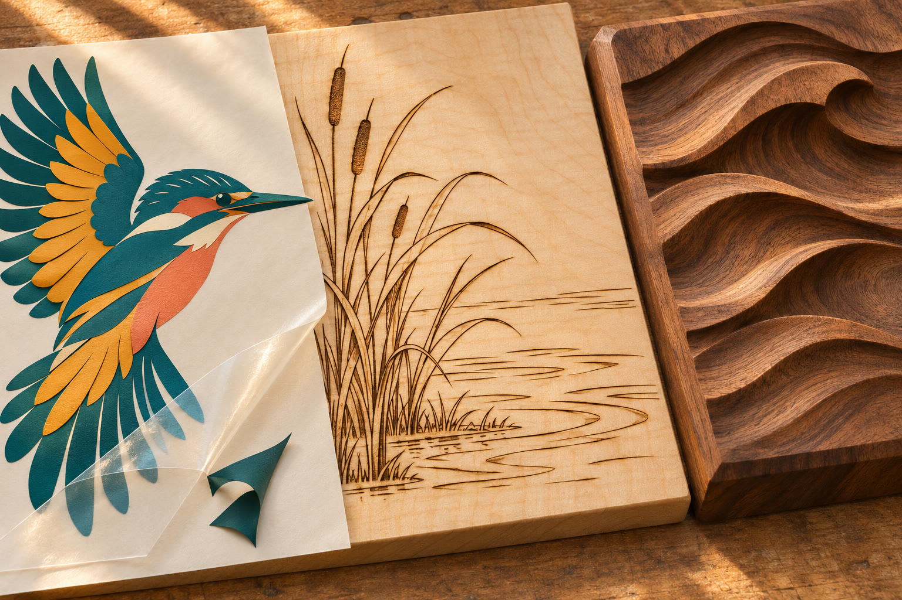
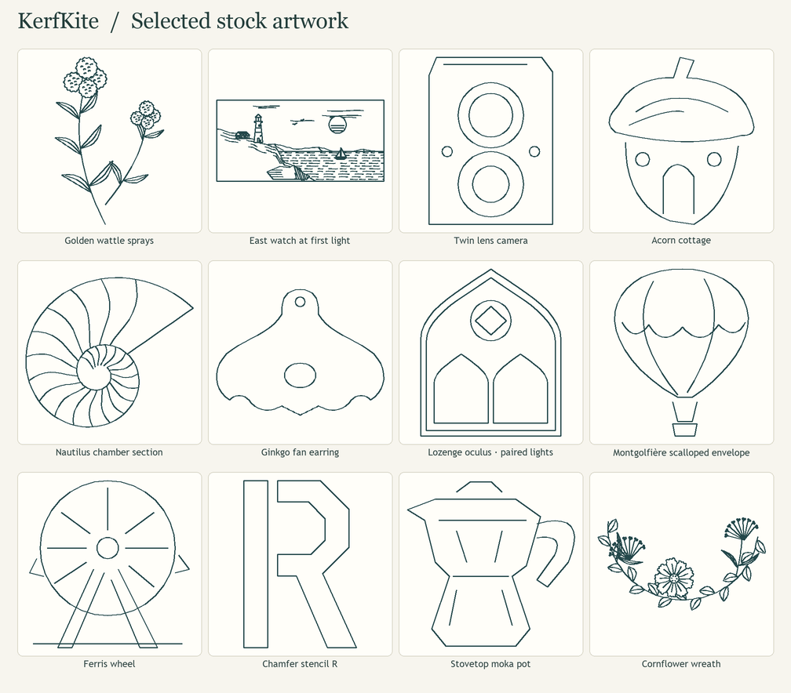
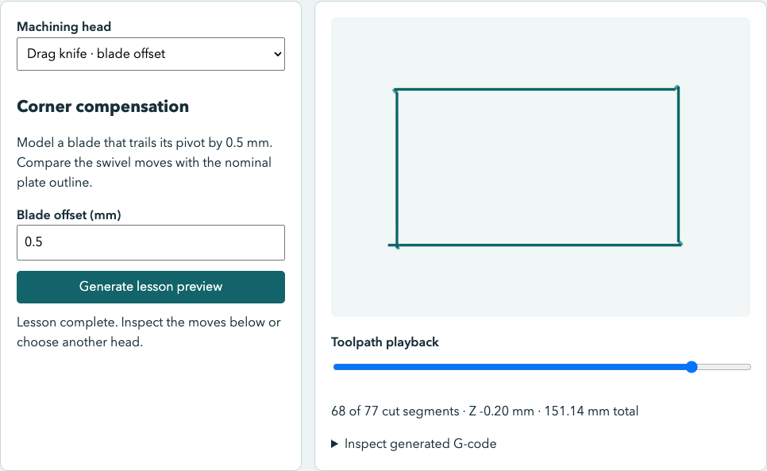

# KerfKite Studio

KerfKite Studio is an open-source CAD/CAM workbench for interchangeable CNC router, laser and drag-knife heads. Design in a browser, simulate a job, and prepare output for a supported controller. The Python application runs locally or as an authenticated HTTPS editor. KerfKite Pocket on Android includes an offline sketch editor and a CNC pendant paired with the Studio server.

*Workshop illustration of the three processes: cut vinyl, laser engraving and router carving.*

## Install KerfKite

Choose the installer for the computer where you want to design. First launch needs an internet connection to set up the desktop tools. After setup, choose **Start workshop**, then **Open Studio** to enter the simulator.

| Device | Download | How to open it |
| --- | --- | --- |
| Windows 10 or 11, 64-bit Intel/AMD | [Windows setup wizard](https://github.com/ShaunPrice/KerfKite/releases/download/v0.3.0/KerfKite-Windows-x64-Setup.exe) | Run Setup, then open **KerfKite Studio** from Start. |
| Mac | [Apple silicon](https://github.com/ShaunPrice/KerfKite/releases/download/v0.3.0/KerfKite-macOS-Apple-Silicon.dmg) · [Intel](https://github.com/ShaunPrice/KerfKite/releases/download/v0.3.0/KerfKite-macOS-Intel.dmg) | Open the disk image, drag **KerfKite Studio** to **Applications**, then open it there. |
| Raspberry Pi OS, 64-bit, or Debian/Ubuntu ARM64 | [ARM64 installer](https://github.com/ShaunPrice/KerfKite/releases/download/v0.3.0/KerfKite-Linux-arm64.deb) | Open the package in the desktop software installer, then launch **KerfKite Studio** from the applications menu. |
| Debian/Ubuntu, 64-bit Intel/AMD | [AMD64 installer](https://github.com/ShaunPrice/KerfKite/releases/download/v0.3.0/KerfKite-Linux-amd64.deb) | Open the package in the desktop software installer. |
| Android, including Samsung Galaxy S23 | [KerfKite Pocket APK](https://github.com/ShaunPrice/KerfKite/releases/download/v0.3.0/KerfKite-Pocket-Android.apk) | Open the download on the phone and tap **Install**. Choose **CNC pendant** to pair with Studio. |

The [installation guide](docs/INSTALL.md) covers first launch, security prompts, updates, removal and optional STEP exchange and controller access, and the source install for HTTPS and MCP services. The [release downloads](https://github.com/ShaunPrice/KerfKite/releases/tag/v0.3.0) also include portable Linux archives and SHA-256 checksums.

For Orange Pi, Radxa, Jetson, BeagleBoard, ODROID, LattePanda and RISC-V systems, the [single-board computer guide](docs/SBC.md) maps each board to its installer. It also includes a browser-only edition for drawing and file export on smaller boards.

## Inside the workshop

* Parametric parts, sketches, Boolean features, assembly mates, interference checks, Bézier/NURBS surface editing and STEP exchange.
* Layer-based laser editing, image processing, material test grids, camera registration and 1,768 original vector templates.
* Router relief, profile and pocket operations, drag-knife paths, rotary file export and simulated fixture clearance.
* Reviewed imports for LightBurn projects and settings, DXF drawings, G-code, HP-GL cutter programs and LinuxCNC workspace settings.

See the [release report (PDF)](docs/KerfKite-Release-Review.pdf), [file compatibility](docs/LIGHTBURN-IMPORT.md), [controller matrix](docs/PROTOCOLS.md) and [platforms](docs/PLATFORMS.md) for tested scope and open work. The machine limits in the public profiles are example dimensions. Enter your measured setup before preparing a physical job.

To trim two crossing lines, open the [geometry guide](docs/GEOMETRY.md). In a solid sketch, you can [trim a crossing, dimension a fillet or constrain a profile](docs/SKETCH.md). A rebuilt solid can update linked machining contours, sections and reliefs. See [solid CAD](docs/SOLID-CAD.md).

For phone control, open **Control → Phone pendant** on the Studio workstation and choose **Enable phone pairing**. Use the private pairing link in Pocket. Wi-Fi, USB tethering and Bluetooth tethering all connect the phone to the same server. See the [connection guide](docs/PHONE-CONNECTIONS.md).

## Stock artwork

Browse **Templates → Template library** to insert one of **1,768 editable designs across 132 categories**. The collection includes Australian wildflowers, natural-history plates, woodcut landscapes, workshop tools, storybook illustrations, decorative panels and stencil lettering.

For an earlier Studio installation or another vector editor, [download the SVG library](https://github.com/ShaunPrice/KerfKite/releases/download/v0.3.0/KerfKite-Stock-Artwork.zip). Extract it and open **index.html** to search the gallery or browse the SVG files by category. The [template catalogue](docs/TEMPLATE-CATALOGUE.md) lists every category and its design count.

## Materials guide

Open **CAM → Materials guide** to choose stock for a flat end mill, ball end mill, V-bit, blue diode laser or drag knife. Compare two materials for the same operation and keep your measured sample results in a portable notebook. To use the guide on its own, [download the single-file materials guide](https://github.com/ShaunPrice/KerfKite/releases/download/v0.3.0/KerfKite-Materials-Guide.html) and open it in your browser. [Guide and workshop examples](docs/MATERIALS.md)

## CNC simulations

**Router stock removal.** The purple lines show three 1 mm depth passes around a 20-tooth gear and its centre bore. The tan surface shows the sampled stock after a 2 mm flat end mill has followed the contours. See the stock from several angles in the [router simulation video (MP4, 7 seconds)](studio/static/simulation-router.mp4).

| Laser engraving | Drag-knife cutting |
| --- | --- |
|  |  |
| Power rises from zero over the first 5 mm of travel. [Watch the laser toolpath (MP4, 8 seconds)](studio/static/simulation-laser.mp4). | The pivot travels around each corner to turn a blade with a 0.5 mm offset. [Watch the knife toolpath (MP4, 8 seconds)](studio/static/simulation-knife.mp4). |

These captures come from KerfKite running in simulator mode. To change the settings and replay the paths yourself, open **Help → Interactive machining lessons** in the running app.

## Development and licensing

Start with [AGENTS.md](AGENTS.md) and the [developer handoff](docs/DEVELOPER.md) for the architecture, simulation and browser tests. The command names `cnc-studio` and `cnc-studio-web` and the project format `pi-cnc-studio/1` preserve interoperability with existing Studio installations.

[MIT](LICENSE) covers first-party software and documentation. Fonts, the bundled parser and native runtime components have their own licences. See the [licensing inventory](docs/LICENSING.md), [contributing guide](CONTRIBUTING.md) and [security policy](SECURITY.md).
