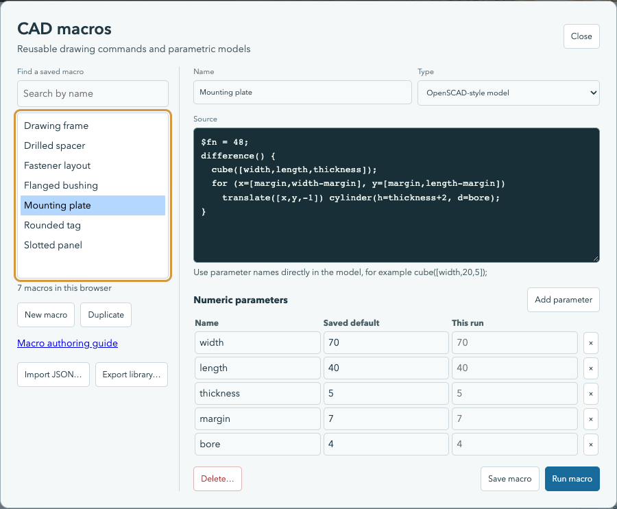

# CAD macros

A macro saves a drawing recipe with named numeric parameters. Use a command macro for separate objects on a layer, such as a border and its alignment line. Use a CAD script macro for a single profile or a solid that needs holes, curves or repeated features.

Open **Macros…** beside the drawing command field, or enter `macros` in the field. The library includes a **Drawing frame** and a **Drilled spacer**. Select one to inspect its source and defaults. Use **Duplicate** to make your own version.



## Draw a measured border and alignment line

1. Choose **New macro**. Name the macro `Border` and select **Drawing and view commands**.
2. Add a parameter named `width` with a default of `18`.
3. Enter the three commands below, one per line. Choose **Save macro** and then **Run macro**.

```text
rect {width} 6 1 2
line 1 5 $width 5
fit drawing
```

The rectangle starts at X 1, Y 2. At the default width it ends at X 19, Y 8. The independent line goes through the middle of the border from (1, 5) to (18, 5). Close the library and enter `macro Border width=32` in the drawing command field for a second set. Both rectangles start at the same point, so their left edges overlap. Move one to see them side by side.

Use `rect` (or `rectangle`), `circle`, `line`, or a supported view command on each line. Both `{width}` and `$width` stand for a numeric argument. Blank lines and comment lines beginning with `#` or `//` are available for notes. Studio checks the sequence before applying it. If a later line contains an invalid command, fix that line and run the sequence again.

## Make a family of solid parts

Create a macro named `Strip`, select **OpenSCAD-style model** and add two parameters, `width` with a default of `12` and `offset` with a default of `0`. Paste this source, save the macro and close the library.

```scad
translate([offset, 0, 0]) cube([width, 6, 3]);
```

From the command field, run each of the following commands separately in a fresh part.

```text
macro Strip width=20
macro Strip offset=40
view top
```

The first strip spans X 0–20. The second uses the default width and spans X 40–52. They are separate pieces of material in the same model, with a combined volume of 576 mm³ and overall dimensions of 52 × 6 × 3 mm. The model history records each run as an editable scripted feature. Dimensions are in millimetres. For a bore or a repeating feature, use the same `difference()`, `for` and `module` syntax as in the script editor. [CAD script language and worked examples](CAD-SCRIPTING.md)

## Save and share a library

**Save** stores a definition in the current browser profile. A parameter’s default controls future runs. Change its run value to try another size. **Run** can also execute the current draft. **Save** keeps that draft for the next session.

Use **Export** in the macro library to download a JSON file. On the other computer, open the library and choose **Import** to select that file. Import merges the definitions with the destination library. An identical definition can be imported again. A different incoming definition with an existing name gets a separate name. Export also provides a backup when changing browser profiles or clearing site data.

To give someone both the design and its reusable recipes, save the Studio project and export the macro library. The project carries the geometry created by each run. To regenerate a CAD script macro on the receiving machine, use an installed Studio service or a hosted workshop with script compilation.

## Starter recipes

The seven recipes below are available the first time you open the library. Dimensions in the table use the shipped defaults. Search by name, select an entry and inspect its source to see how its geometry is built. In a fresh project, run `macro Mounting plate` and `view top` to inspect the plate by itself.

| Macro | Default result | Parameters and a change to try |
| --- | --- | --- |
| Drawing frame | One 60 × 30 mm rectangle at the origin, followed by a fitted drawing view. | `width`, `height`. Try `macro Drawing frame width=90 height=40`. |
| Fastener layout | Four 4 mm diameter circles with centres at (8, 8), (52, 8), (52, 28) and (8, 28). | `radius`, `left`, `right`, `bottom`, `top`. Set `right=72` to widen the spacing. |
| Rounded tag | One 60 × 24 mm flat outline with 4 mm corner radii and a 5 mm hole at (8, 12). | `width`, `height`, `corner`, `hole`. Keep the hole clear of the edge when changing the corner radius. |
| Slotted panel | One 80 × 40 mm flat panel with four 34 × 3 mm round-ended slots. Their centre lines fall at Y 8, 16, 24 and 32. | `width`, `height`, `slots`, `slot_length`, `slot_width`. Set `slots=3` to space three slots evenly. Use a positive whole number for the count. |
| Drilled spacer | An 18 mm diameter, 8 mm tall cylinder with a 6 mm through-bore. | `outer`, `bore`, `height`. Try `macro Drilled spacer outer=24 bore=8 height=12`. |
| Mounting plate | A 70 × 40 × 5 mm solid with four 4 mm through-bores. The holes lie 7 mm in from each adjacent edge. | `width`, `length`, `thickness`, `margin`, `bore`. Increase `width` to move the right-hand hole pair. |
| Flanged bushing | A 14 mm diameter body with a 22 mm diameter flange and an 8 mm through-bore. Overall length is 16 mm, including the 3 mm flange. | `body`, `flange`, `bore`, `length`, `lip`. Keep the bore smaller than the body to retain a wall. |

## Command and parameter reference

Macro names are unique in a library, ignoring case. Spaces are allowed. Type `macro Drilled spacer height=12` without quotation marks. Separate assignments with spaces and keep each `name=value` together. Macro names can contain 1–64 characters, excluding control characters and the equals sign. Parameter names are case-sensitive. Start with an ASCII letter or underscore and use letters, digits and underscores thereafter. Choose descriptive names such as `bore_diameter`. Language keywords such as `for` and `module`, and reserved names such as `constructor`, cannot serve as parameters.

A parameter name can be up to 40 characters. Every parameter needs a finite numeric saved default from −100000 to 100000. The same range applies to run values. Blank **This run** fields use those defaults. A value entered for this run or supplied on the command line takes precedence for that run. A CAD script macro receives the resulting values as named parameters. They override same-named part parameters and source defaults. The applied scripted feature keeps its per-run inputs, so changing the library default later leaves that instance at the size it was built.

| Command in a sequence | Arguments and units |
| --- | --- |
| `rect width height [x y]` or `rectangle width height [x y]` | Width and height must be positive. Optional X and Y give the lower-left corner in millimetres. Both default to zero. |
| `circle radius [cx cy]` | A positive radius followed by an optional centre in millimetres. The default centre is (radius, radius). |
| `line x1 y1 x2 y2` | Two distinct endpoints in millimetres. |
| `fit`, `fit drawing`, `fit bed` | Frame the current workspace, visible drawing objects, or full work area. |
| `view top`, `bottom`, `front`, `back`, `left`, `right`, `iso` | Set the solid camera orientation. `view` is optional for named orientations. |
| `zoom factor`, `pan dx dy`, `orbit yaw pitch` | Zoom by a positive factor, pan by pixels or orbit by degrees. |

A parameter placeholder replaces one complete numeric token in a command sequence. For arithmetic, loops and geometry combinations, choose **OpenSCAD-style model** and use expressions such as `width/2` and `for (i=[0:3])`. A script can yield one planar region with several contours or one solid with several connected components. A script that combines 2D and 3D shapes needs an explicit conversion such as `linear_extrude()` or `projection()`. [Script reference and examples](CAD-SCRIPTING.md)

## File format and limits

A library can hold 100 definitions, with up to 32 numeric parameters per definition. Each UTF-8 source can occupy up to 64 KiB. The exported or merged library must fit within 1 MiB. A command sequence can contain up to 256 executable lines. The destination project can contain up to 3,000 paths and 100,000 drawing vertices after applying a command sequence. Scripted geometry has additional tessellation and evaluation limits.

To author a portable library by hand, save the following UTF-8 text in a `.json` file, choose **Import JSON…**, then run `macro Label width=45`. The example adds a 45 × 12 mm rectangle. `kind` accepts `commands` or `scad`. In JSON, use `\n` between source lines. Each definition supplies `parameters`, including an empty `{}` for recipes with no parameters.

```json
{
  "format": "kerfkite-cad-macros",
  "version": 1,
  "macros": [
    {
      "name": "Label",
      "kind": "commands",
      "source": "rect {width} 12\nfit drawing",
      "parameters": {"width": 30}
    }
  ]
}
```

The manager checks the entire import before adding definitions. For a name collision with different source, kind or defaults, look for the incoming name with a numeric suffix such as **Label (2)**. The exported file contains the saved definitions and defaults. Choose **Save macro** before exporting to include your current edits. **Duplicate** creates an editable copy. **Delete…** removes the selected saved definition from this browser after confirmation. If another window changes a definition you are editing, duplicate your draft or reopen the latest saved entry.

## Troubleshooting a run

| Editor feedback or symptom | What to inspect |
| --- | --- |
| Unknown parameter | Match case and spelling with the parameter table. In command sequences, use `{name}` or `$name`. In script source, use the bare name. |
| Error on line N | Inspect that line before running again. A negative circle radius or repeated line endpoint is invalid. A syntax error in script source can also identify a column. |
| Shape exceeds the work area | Check both the size and the position. A circle centred at X 0 extends past the left edge for any positive radius. |
| Repeated run appears to do nothing | Instances at identical coordinates overlap. Change a position parameter or select one instance and move it to inspect both. |
| Empty script result or excessive geometry | Check the input dimensions and booleans. Use a smaller `$fn`, fewer copied features or fewer extrusion slices. |
| The library is missing on another device | Use **Export library…** in the source browser, then **Import JSON…** in the destination browser. Project files and macro libraries have separate formats. |
| Cannot save in this browser | Check site-storage permission and available space. The local-file and hosted editors can have separate browser storage. |
