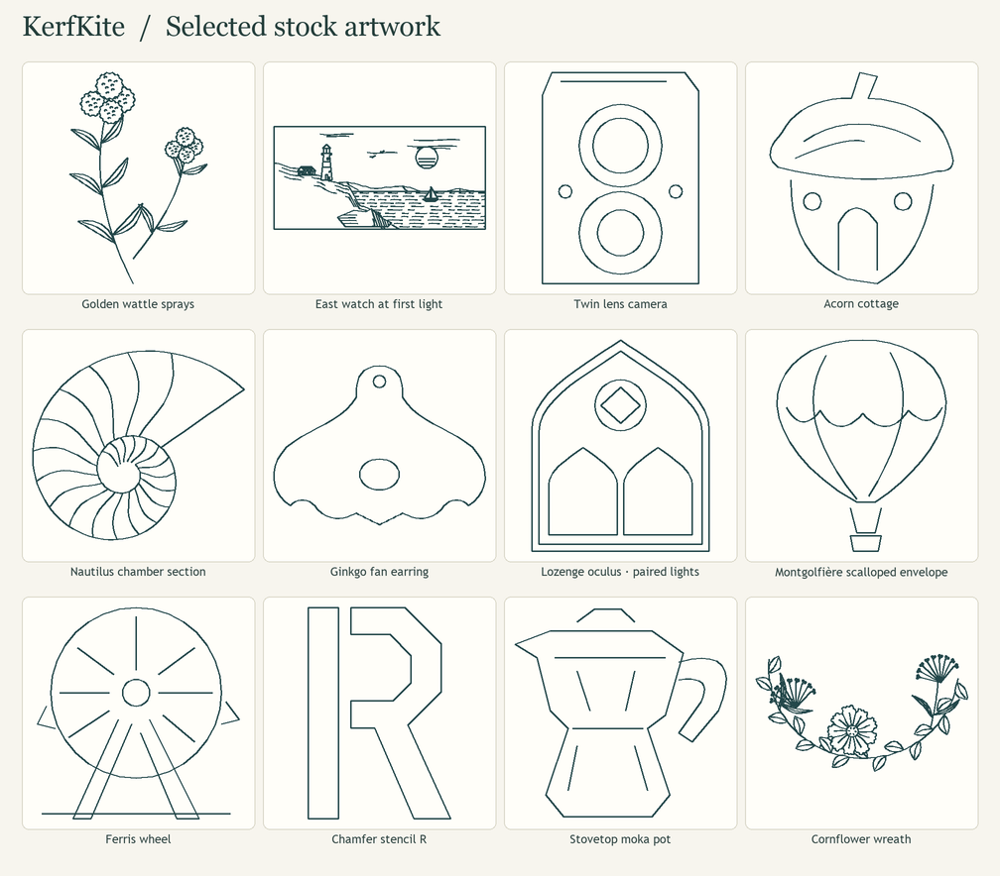

# Template catalogue

1768 original built-in vector templates across 132 categories. The browser and MCP share the same artwork.

Open **Templates → Template library**, choose a category or search, then click an image to insert it. Previous/Next pages show 36 previews at a time. Favourites and custom templates remain available.

Download the [SVG stock library](https://github.com/ShaunPrice/KerfKite/releases/download/v0.2.2/KerfKite-Stock-Artwork.zip) for other editors or an earlier Studio installation. Extract the archive and open **index.html** to browse labelled previews. The catalogue keeps each SVG in its category folder. Closed paths describe outlines or holes. Open strokes are usually engraving details.

| Category | Templates |
|---|---:|
| Address numerals | 10 |
| Aerostat studies | 6 |
| Agate cross sections | 8 |
| Alpine woodcuts | 4 |
| Ammonites & chambered shells | 8 |
| Analogue photography | 8 |
| Animal portraits | 24 |
| Animals & pets | 8 |
| Architectural friezes | 12 |
| Art Deco escutcheons | 12 |
| Astronomy equipment | 8 |
| Australian wildflower studies | 10 |
| Baker’s counter | 8 |
| Balcony ironwork | 12 |
| Birds of the shore | 8 |
| Blank cameo surrounds | 12 |
| Bookbinding corner tools | 12 |
| Bookmarks | 16 |
| Botanical corners | 15 |
| Botanical dividers | 25 |
| Botanical frames | 15 |
| Botanical vines | 17 |
| Bridal buttonholes | 10 |
| Bud vase engravings | 10 |
| Butterflies | 12 |
| Camp equipment | 8 |
| Cars & road vehicles | 25 |
| Celebrations | 8 |
| Ceramic forms | 8 |
| Children’s toy artwork | 12 |
| Coastal navigation | 8 |
| Coastal woodcuts | 4 |
| Coasters | 16 |
| Coffee and tea rituals | 8 |
| Compass marquetry | 12 |
| Crescent floral wreaths | 10 |
| Crystal specimens | 10 |
| Decorative borders | 24 |
| Desert woodcuts | 3 |
| Drawer & hamper labels | 12 |
| Engine-turned engraving | 12 |
| Fairground rides | 8 |
| Fairy dwellings | 8 |
| Feather studies | 8 |
| Fern specimens | 8 |
| Finial bookmarks | 12 |
| Floral corners | 30 |
| Floral place-card swags | 10 |
| Floral sprays | 30 |
| Flowers | 56 |
| Food & kitchen | 8 |
| Frames | 19 |
| Frost & ice crystals | 10 |
| Fruit & orchard | 20 |
| Garden & growing | 8 |
| Garden flowers | 30 |
| Geometric patterns | 16 |
| Geometric tilework | 12 |
| Gift box apertures | 12 |
| Hand-tied bouquets | 10 |
| Hanging ornaments | 16 |
| Herbs & spices | 20 |
| Historic buildings | 20 |
| Houseplant accessories | 8 |
| Insects | 18 |
| Jewellery | 12 |
| Joinery tools | 8 |
| Lattice screens | 12 |
| Learning & play | 12 |
| Leaves | 20 |
| Mandalas | 16 |
| Meadow border panels | 10 |
| Moonlit nursery | 8 |
| Motorbikes & cycles | 12 |
| Mountain scenes | 16 |
| Mushrooms & fungi | 20 |
| Music | 8 |
| Music notation | 30 |
| Musical instruments | 33 |
| Nature & landscapes | 12 |
| Nautical | 8 |
| Ornamental swirls | 19 |
| Outdoor camp kitchen | 8 |
| Pantry implements | 8 |
| Paper and book arts | 8 |
| Patchwork blocks | 12 |
| Pelagic wildlife | 8 |
| Personal library plates | 12 |
| Personalisation coasters | 12 |
| Pierced earring blanks | 12 |
| Plaster ceiling roses | 12 |
| Playground sketches | 8 |
| Pressed flower mounts | 10 |
| Printer’s rules | 12 |
| Printmaker’s studio | 8 |
| Puppet theatre | 8 |
| Ribbon-slot bag charms | 12 |
| River scenes | 16 |
| River woodcuts | 3 |
| Running stitch samplers | 12 |
| Sand dollars & sea biscuits | 8 |
| Scallops & bivalves | 8 |
| Seaside storybook | 8 |
| Seasonal | 12 |
| Seed pods & samaras | 8 |
| Sewing basket | 8 |
| Sound and recording | 8 |
| Space & astronomy | 8 |
| Stars of the reef | 8 |
| Stencil initials | 26 |
| Stone tracery | 12 |
| Succulents & cacti | 20 |
| Symbols | 28 |
| Table display picks | 12 |
| Tabletop play | 8 |
| Tags & badges | 24 |
| Textile workshop | 8 |
| Timekeeping and optics | 8 |
| Toy chest | 8 |
| Transom fanlights | 12 |
| Travel & outdoors | 8 |
| Travellers’ keepsakes | 8 |
| Trees | 50 |
| Two-point pendants | 12 |
| Veneer inlay bands | 12 |
| Vines | 24 |
| Wave engraving panels | 12 |
| Wheat & grain | 50 |
| Workshop & makers | 8 |
| World landmarks | 12 |
| Wreaths | 14 |
| Writing gift tags | 12 |

Artwork is original procedural vector line art, included under the project MIT licence. Botanical and animal studies are stylised rather than scientific illustrations. Landmark drawings are artistic interpretations, not measured architectural plans. Existing IDs are preserved.

Templates contain geometry, not preconfigured cutting jobs. Toy designs and learning boards are scalable craft patterns, not validated mechanical assembly plans or certified children's products. Set dimensions, material thickness, hole sizes and fit allowances before fabrication. Some designs combine closed outlines and open engraving detail; assign appropriate operations. Stencil bridges, one-piece silhouette unions and automatic assembly tolerances are not included. Physical cut quality and suitability require review.

Regenerate this catalogue and the MCP snapshot with `node scripts/build_templates.cjs`.
